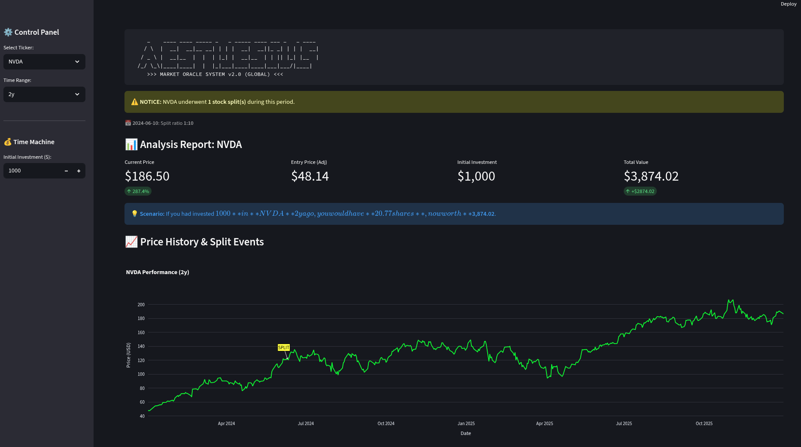

# Heimdall | Market Dashboard

> *"Data is merely noise until logic gives it a voice."*

An interactive stock dashboard that turns raw market data into signals: RSI tracking, split-adjusted return simulation and automatic stock split detection.

## ◼ Overview

**Heimdall** bridges the gap between raw market data and readable insight. This repository contains the **web dashboard**, built with Streamlit and Plotly. A lightweight terminal scanner for quick RSI checks lives in the companion project, [Project_Hugnin](https://github.com/fas0ftware/Project_Hugnin).

## ◼ Preview



## ◼ Features

**Interactive dashboard**
- **Market data:** Fetches historical data from Yahoo Finance for AAPL, TSLA, NVDA, MSFT, GOOGL, AMZN, META and COIN, over ranges from 1 month up to the full history.
- **RSI indicator:** 14-period RSI (Wilder's smoothing) shown as a metric and in its own chart panel, with bands that mark oversold (below 30) and overbought (above 70) conditions.
- **Interactive charts:** Zoomable Plotly charts with price and RSI sharing one time axis.

**Time machine simulation (ROI calculator)**
- **"What if" scenarios:** Shows what an investment of a chosen amount, made at the start of the selected time range, would be worth today.
- **Adjusted prices:** Prices come from yfinance with auto-adjust enabled, so splits (and dividends) do not distort the result.

**Split hunter**
- **Auto-detection:** Scans price history for stock splits and lists each one with its date and ratio (for example, `10-for-1`; reverse splits are shown as `1-for-10 (reverse)`).
- **Visual markers:** Highlights split events directly on the chart so they are not mistaken for price crashes.

## ◼ Project structure

```
Project_Heimdall/
├── dashboard.py          # Streamlit app (UI and charts)
├── indicators.py         # RSI, RSI labels and split ratio formatting
├── tests/
│   └── test_indicators.py
├── dashboard_preview.png # Screenshot used in this README
└── requirements.txt      # Dependencies
```

## ◼ Requirements

- Python 3.9 or newer
- pip
- An internet connection (market data is fetched online)

## ◼ Installation

```bash
git clone https://github.com/fas0ftware/Project_Heimdall.git
cd Project_Heimdall
```

Create and activate a virtual environment.

Linux / macOS:

```bash
python3 -m venv venv
source venv/bin/activate
```

Windows:

```bash
python -m venv venv
venv\Scripts\activate
```

Install dependencies:

```bash
pip install -r requirements.txt
```

## ◼ Usage

Launch the dashboard in your default browser:

```bash
streamlit run dashboard.py
```

Run the indicator tests (only needs pandas):

```bash
python tests/test_indicators.py
```

## ◼ Notes and limitations

- Data availability and accuracy depend on the upstream data provider, and values can be delayed or incomplete.
- The ROI simulation is a historical calculation, not a prediction.
- RSI is one indicator among many and should not be used alone. Short time ranges (such as 1 month) show only a few RSI points because the first 14 values need warm-up data.
- `dashboard_preview.png` was taken before the RSI panel was added and may not match the current layout.

## ◼ Disclaimer

This software is for educational and informational purposes only. It does not constitute financial advice.

---

Part of the **FA Software** projects.
