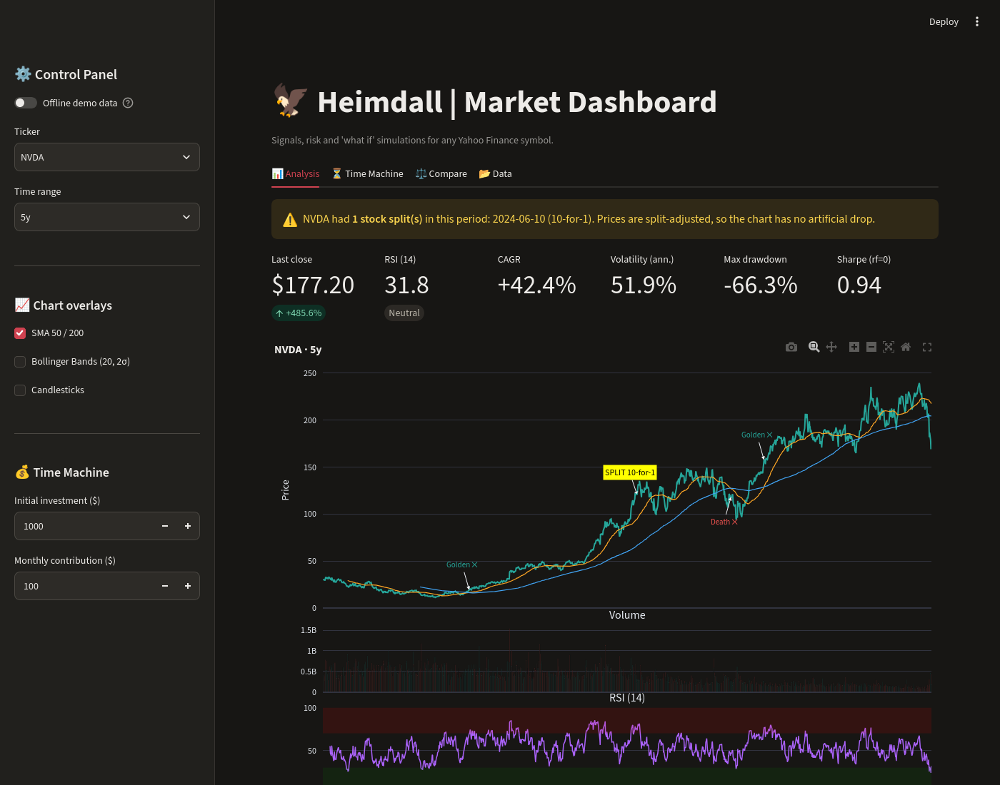
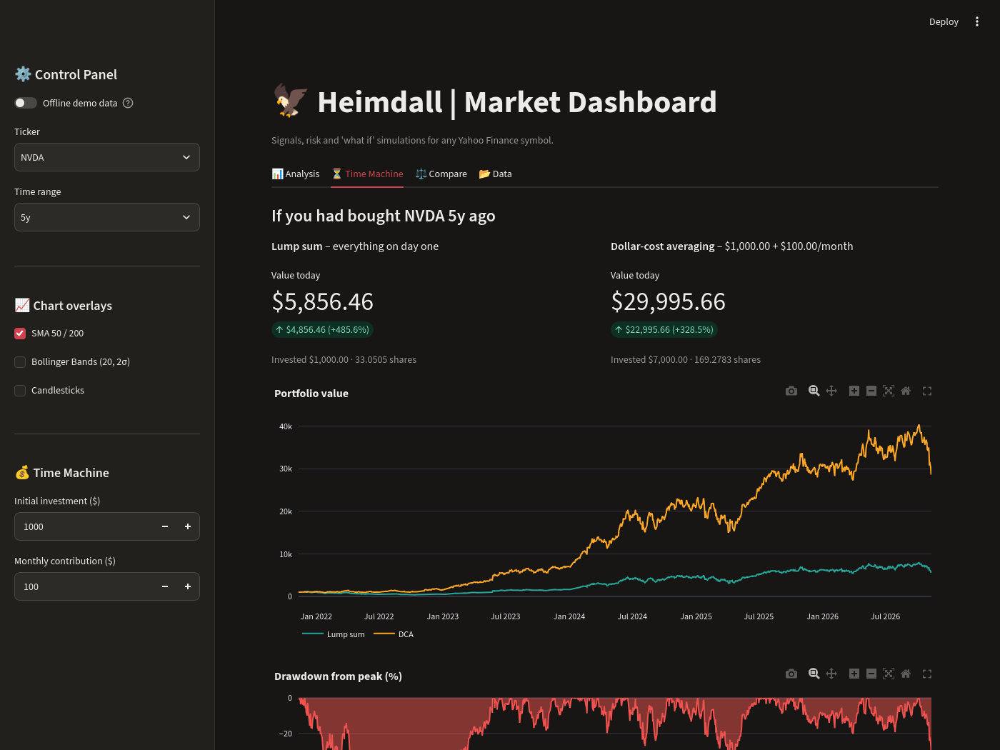
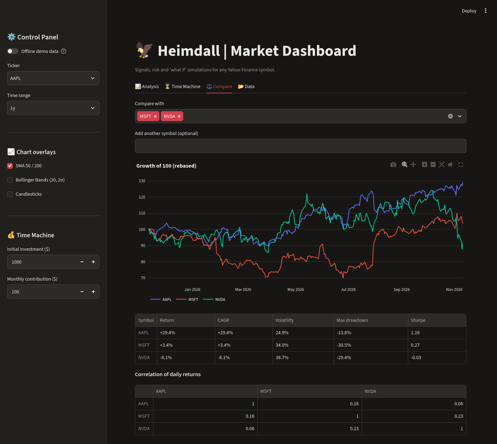
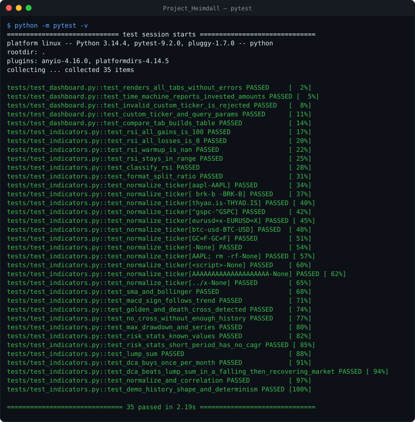
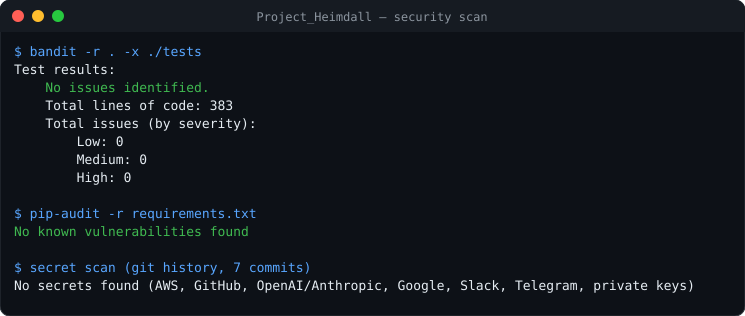

# Heimdall | Market Dashboard

> *"Data is merely noise until logic gives it a voice."*

[](https://github.com/fas0ftware/Project_Heimdall/actions/workflows/ci.yml)


An interactive stock dashboard that turns raw market data into signals, risk numbers and "what if" simulations. Works with **any Yahoo Finance symbol** – US stocks, Borsa Istanbul (`THYAO.IS`), indices (`^GSPC`), crypto (`BTC-USD`), FX (`EURUSD=X`) and futures (`GC=F`).

A lightweight terminal scanner for quick RSI checks lives in the companion project, [Project_Hugnin](https://github.com/fas0ftware/Project_Hugnin).



## ◼ Features

**📊 Analysis**
- Line or **candlestick** price chart with **volume**, **RSI (14, Wilder)**, **MACD (12/26/9)** panels on one shared time axis.
- **SMA 50/200** with automatic **golden ✕ / death ✕** cross markers, optional **Bollinger Bands (20, 2σ)**.
- **Split hunter** – every stock split is listed with its ratio (`10-for-1`, `1-for-10 (reverse)`) and marked on the chart, so adjusted prices are never mistaken for a crash.
- **Risk metrics** – total return, CAGR, annualized volatility, maximum drawdown, Sharpe ratio.

**⏳ Time Machine**
- **Lump sum vs. dollar-cost averaging** (initial amount + monthly contribution on the first trading day of each month) with portfolio-value curves.
- **Drawdown chart** – how far below its previous peak the price was at every point.

**⚖️ Compare**
- Any number of symbols rebased to 100, a risk table side by side and the **correlation matrix** of daily returns.

**📂 Data** – the raw OHLCV table with a **CSV download**.

**Also**
- **Shareable deep links**: `?t=NVDA&r=5y&view=machine` opens NVDA, 5 years, Time Machine tab.
- **Offline demo mode** (sidebar toggle or `HEIMDALL_DEMO=1`) with synthetic prices – try it without a network.
- Ticker input is validated before it reaches the data provider; data is cached for 15 minutes.

<p align="center">
  
  
</p>

## ◼ Quick start

```bash
git clone https://github.com/fas0ftware/Project_Heimdall.git
cd Project_Heimdall
python3 -m venv venv && source venv/bin/activate   # Windows: venv\Scripts\activate
pip install -r requirements.txt
streamlit run dashboard.py
```

## ◼ Using the calculations elsewhere

All maths lives in [`indicators.py`](indicators.py), which has no Streamlit dependency:

```python
import yfinance as yf
from indicators import calculate_rsi, macd, ma_crosses, risk_stats, dca

close = yf.Ticker("AAPL").history(period="5y")["Close"]
print(calculate_rsi(close).iloc[-1])
print(ma_crosses(close))                   # golden / death crosses
print(risk_stats(close))                   # return, CAGR, vol, drawdown, Sharpe
result, curve = dca(close, amount=1000, monthly=100)
print(result.invested, result.value, result.roi)
```

## ◼ Tests

35 tests: indicator maths against known values (RSI edge cases, MACD sign, SMA/Bollinger, cross detection, drawdown, CAGR/Sharpe, lump sum and DCA), ticker validation (including injection-style input), deterministic demo data, and **headless UI tests** that render every tab with Streamlit's `AppTest`.

```bash
pip install -r requirements-dev.txt
python -m pytest -v
```



## ◼ Security

CI runs [bandit](https://github.com/PyCQA/bandit) and [pip-audit](https://github.com/pypa/pip-audit) on every push. Latest local scan, including a secret scan of the full git history:



## ◼ Project structure

```
Project_Heimdall/
├── dashboard.py            # Streamlit app (tabs, charts)
├── indicators.py           # RSI, MACD, SMA, Bollinger, crosses, risk, DCA, demo data
├── .streamlit/config.toml  # Dark theme
├── tests/
│   ├── test_indicators.py
│   └── test_dashboard.py   # AppTest UI tests (offline)
└── docs/                   # README images
```

## ◼ Notes and limitations

- Data comes from Yahoo Finance through the unofficial `yfinance` library: it can be delayed, incomplete or temporarily unavailable.
- Simulations ignore fees, taxes, slippage and dividends paid in cash (prices are dividend-adjusted).
- Sharpe ratio uses a 0 % risk-free rate.
- Indicators need warm-up: RSI needs 14 days, SMA 200 needs 200 days of history.

## ◼ Changelog

- **2.0.0** – Any symbol, candlesticks, volume, MACD, SMA 50/200 with cross markers, Bollinger Bands, risk metrics, DCA vs lump sum, drawdown chart, multi-symbol comparison with correlation, CSV export, deep links, offline demo mode, input validation, pytest + AppTest suite, CI security scans.
- **1.0.0** – 8 tickers, RSI panel, lump-sum ROI, split detection.

## ◼ Disclaimer

This software is for educational and informational purposes only. It does not constitute financial advice.

---

Part of the **FA Software** projects. Licensed under the [MIT License](LICENSE).
